# Cyberpunk 2077 — Crimson Veil / Velo Carmesí (`v0.9.0`)
### *Techno-Occult Narrative Expansion Starring Misty Olszewski & V* — **3-Part Voiced Campaign (`Prologue` + `Act I` + `Act II` + `3 Endings`)** · **100% Bilingual (`EN` & `ES`: `410` Studio Voice Lines + `4` SFX)** · **100% Base Game `2.x`**

[](LICENSE)
[](https://www.nexusmods.com/cyberpunk2077/mods/39814)
[](https://youtu.be/97ip0hhgN1c)
[](https://github.com/0utKast/cyberpunk2077-crimson-veil/releases/tag/v0.9.0)
[](#universal-compatibility)
[](#language--voice-transparency)
[](fanfic/Crimson_Veil_Illustrated_Novella_EN.pdf)

<p align="center">
  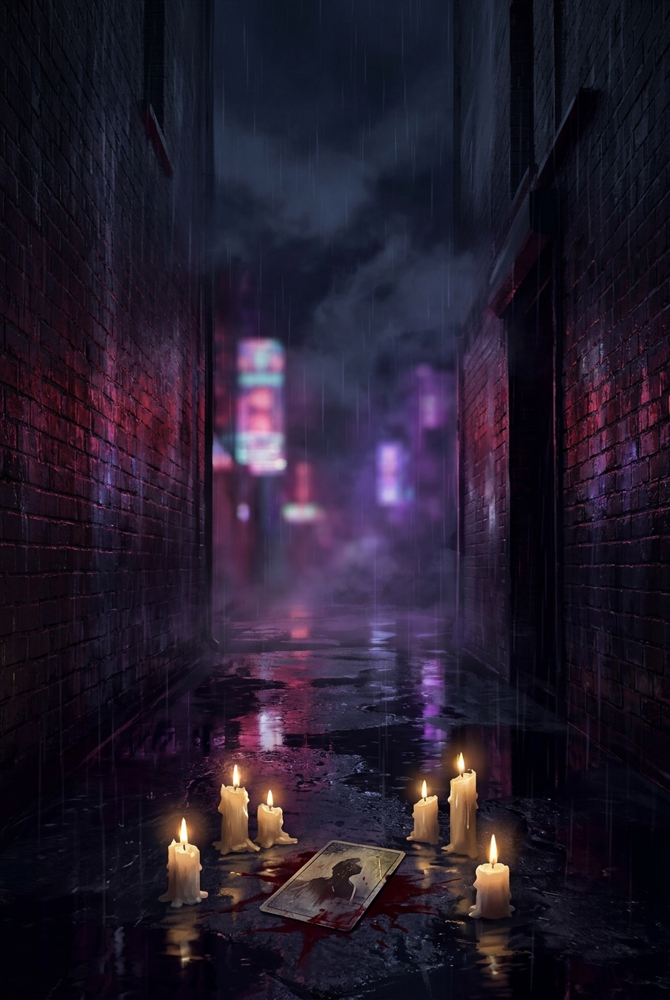
</p>

> **🌍 Navigation & Direct Downloads / Navegación y Descarga Directa (`v0.9.0`):**
> - 🧩 **[Nexus Mods Page (`cyberpunk2077/mods/39814`)](https://www.nexusmods.com/cyberpunk2077/mods/39814)**
> - 🎬 **[Watch the Official 4K Trailer on YouTube (`youtu.be/97ip0hhgN1c`)](https://youtu.be/97ip0hhgN1c)**
> - 📦 **[Download `CrimsonVeil_v0.9.0.zip` (GitHub Release `v0.9.0`)](https://github.com/0utKast/cyberpunk2077-crimson-veil/releases/tag/v0.9.0)** — *Unified Bilingual Mod Package (Full English & Full Spanish Voice-Over + Text Included)*
> - 📖 **[Download `Crimson_Veil_Illustrated_Novella_EN.pdf` (`39` Pages)](fanfic/Crimson_Veil_Illustrated_Novella_EN.pdf)** — *Illustrated Companion Novella ("Blood Beneath the Neon", rendered offline in Typst with 21 4K plates & 5 Tarot illustrations)*
> - 🇺🇸 **[English Documentation (Campaign, Mechanics, Endings & Install)](#english-documentation)**
> - 🇪🇸 **[Documentación en Español (Campaña, Finales, Armas e Instalación)](#documentación-en-español)**
> - ⚖️ **[Credits & Open Modding Permissions (`CREDITS.md`)](CREDITS.md)** · 📄 **[MIT License (`LICENSE`)](LICENSE)**

---

<a name="english-documentation"></a>
# 🇺🇸 English Documentation

## 1. Overview & Premise
> *"The Moon means: I am awake in the darkness, yet I cannot step into the light."*

**Crimson Veil (`v0.9.0`)** (*Velo Carmesí*) is a standalone, fully voiced techno-occult narrative expansion for **Cyberpunk 2077 (`2.x` Base Game — no *Phantom Liberty* DLC required)** starring **Misty Olszewski** (strictly non-combatant) and **V** investigating Night City's nocturnal biosculpt cult **"The Pale Chorus"** and experimental pulmonary compound **NOX-9**.

When several young Watson residents vanish without leaving scavenged chrome behind, a makeshift shrine of six damp wax candles and a single blood-stained Tarot card (*The Moon*) appears at the back entrance of *Misty's Esoterica*. Kiroshi forensic scans reveal traces of synthetic hemoglobin, an experimental stabilizer, and reactive porphyrins—pointing to **Lucía Reyes (`Subject L-14`)**, a 23-year-old neighbor using Misty's private Tarot lessons as an SOS written in her own blood.

---

## 2. Gallery & Bespoke Tarot Illustrations

| Misty's Holocall (`Watson`) | Esoterica Rooftop (`22:00`) | Interactive Codeware Tarot UI |
| :---: | :---: | :---: |
| 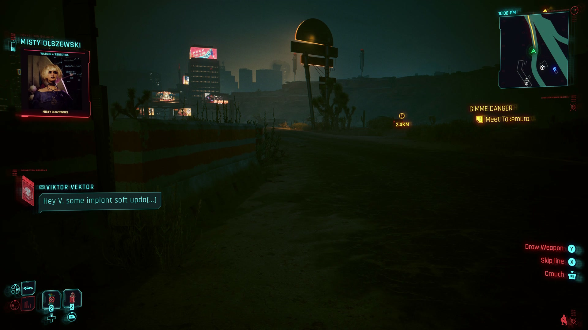 | 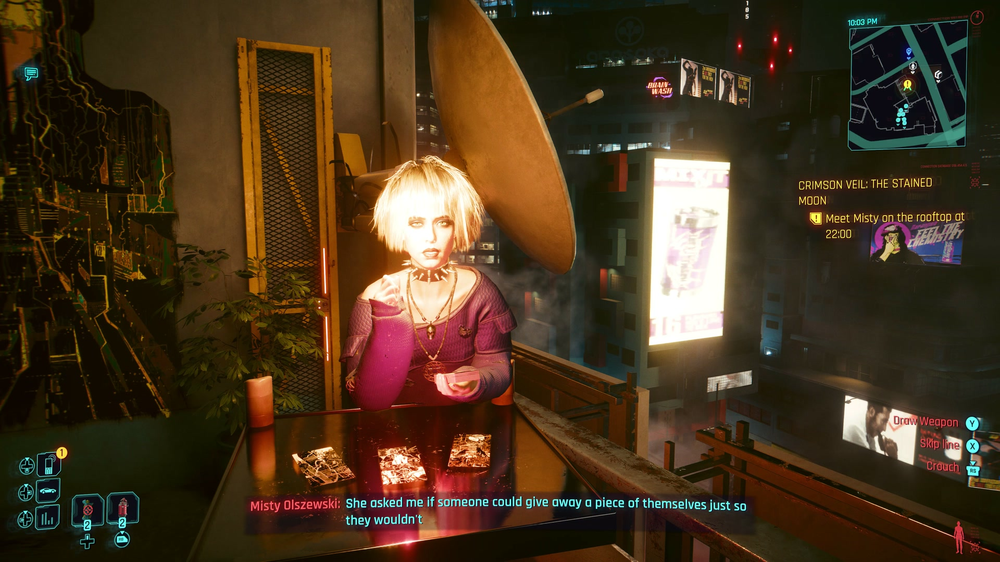 | 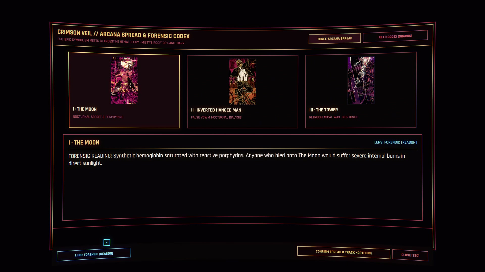 |

| Dr. Valdés's Little China Alley | Geothermal Bunker (`Badlands`) | Confronting "The Cantor" & Epilogue |
| :---: | :---: | :---: |
| 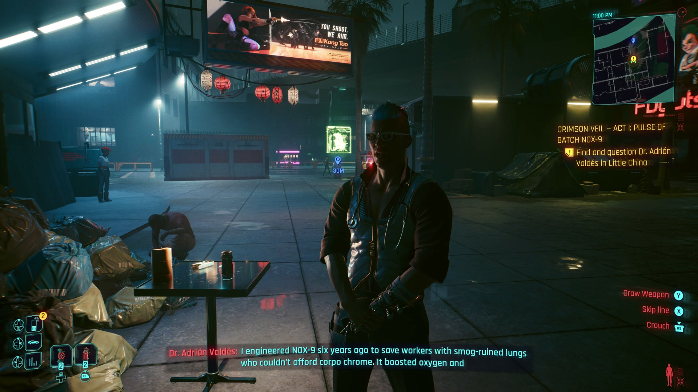 | 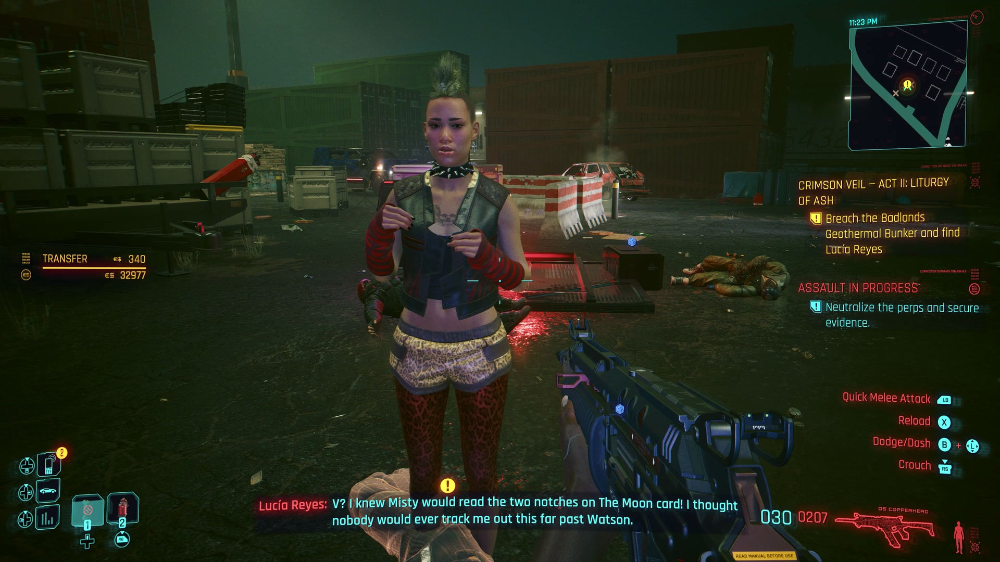 | 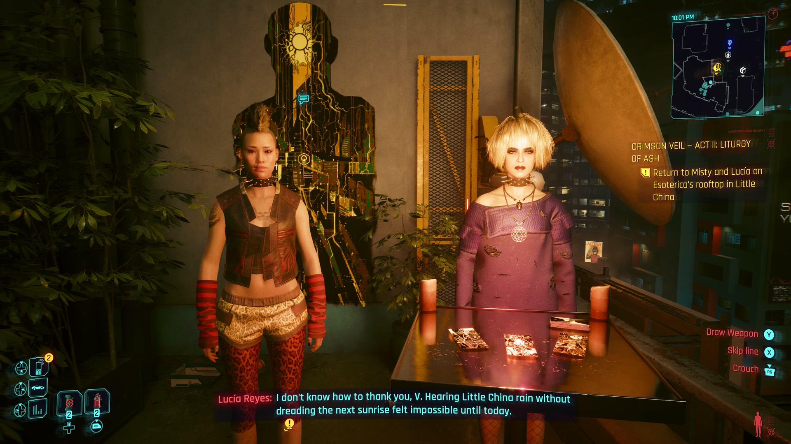 |

<details>
<summary><b>🃏 Click to expand the 4 Bespoke Cyberpunk-Esoteric Tarot Cards (Illustrated Companion Edition)</b></summary>

| XVIII · The Moon | II · The High Priestess | XII · The Hanged Man | XVI · The Tower |
| :---: | :---: | :---: | :---: |
| 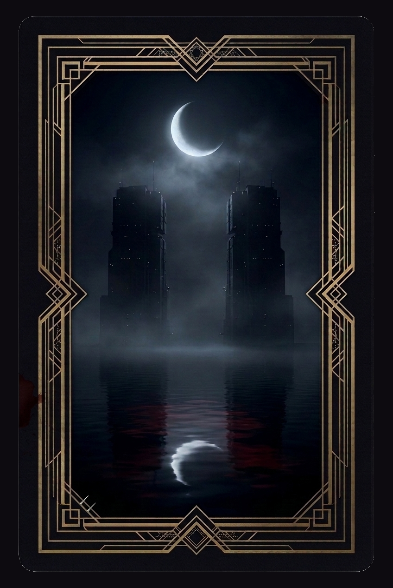 | 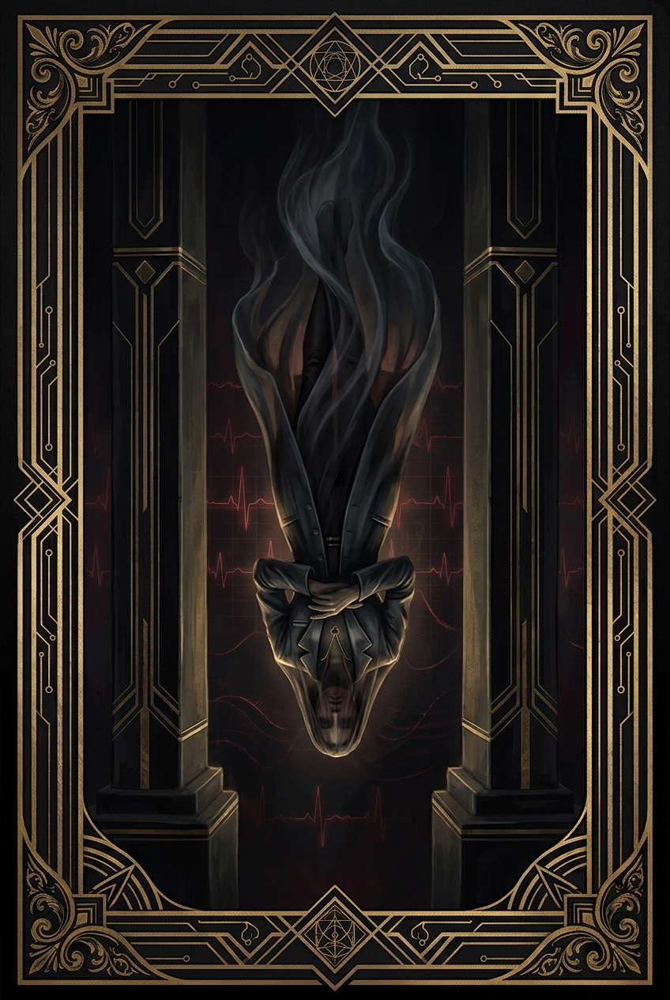 | 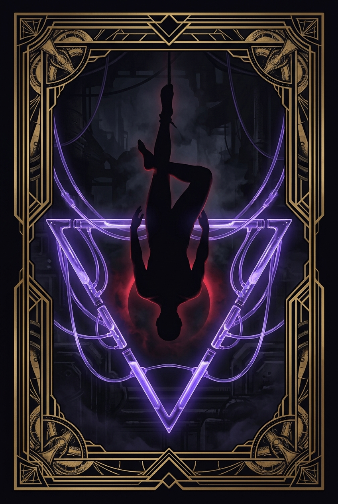 | 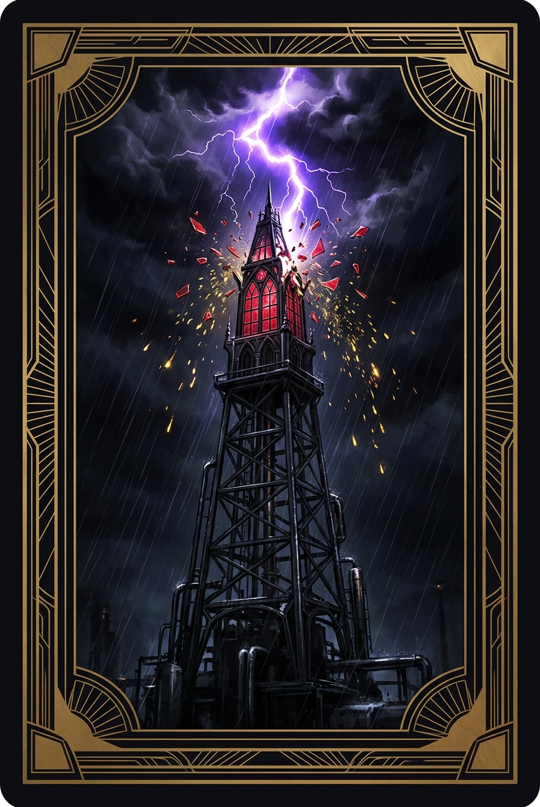 |

</details>

---

## 3. Campaign Architecture (3 Full Story Acts + 3 Endings)

1. **Prologue — *The Stained Moon*:**
   - **Automatic Holocall Start:** Triggers automatically in calm free roam once **Act 2 (`Playing for Time`)** is reached and **V is Level `>= 10`** (out of combat, `> 15 m` from Misty's Esoterica). Also startable manually at any time via the optional CET debug panel.
   - **Esoterica Back Alley & Kiroshi Forensics:** Scan the six damp candles and stained *Moon* card (`synthetic hemoglobin + reactive porphyrins + Lucía's fingernail SOS code`), interrogate Misty on missing Northside tech **Mateo (`M-09`)**, and meet on Esoterica's rooftop at **22:00** under a `365 nm` UV lamp.
   - **Northside Oilfields Incursion:** Scout Pale Chorus sentries, trigger the **24 m `365 nm` UV Emitter overload**, recover the empty **NOX-9 vial** and torn transfer receipt confirming **Lucía Reyes (`L-14`)** is alive, and earn **+1,200 E$**, **+500 XP**, and iconic neurotoxin knife ***Pale Fang* (`Colmillo Pálido`)**.
2. **Act I — *Pulse of Batch NOX-9*:**
   - Trace the pharmaceutical batch from a **Kabuki canal shrine** & cryo cooler to fugitive hematologist **Dr. Adrián Valdés** hiding in a secluded street-level southern Little China alley.
   - Infiltrate the **West Pier cryogenic terminal** (cleanly positioned in the open courtyard away from ambient crowds) to uncover how **Dra. Helena Solís ("The Cantor")** weaponized Valdés's serum into forced nocturnal servitude.
   - Debrief with Misty to earn the iconic suppressed pistol ***Silent Veil* (`Velo Silente`)**.
3. **Act II — *Liturgy of Ash*:**
   - Investigate the ambushed **Biotechnica Flats** convoy (`3` forensic clues revealing **Mateo M-09**'s sacrifice to protect Lucía's transfer), track the signal to the closed **Badlands geothermal bunker**, break through the `365 nm` UV perimeter, speak with **Lucía Reyes (`L-14`)**, and confront **Dra. Helena Solís (`"The Cantor"`)** inside the **NOX-9B Bioreactor Chamber**.
   - **Three Playable Endings:**
     - **Ending A · *The Second Serum*:** Defeat Solís, preserve the purified `NOX-9B` formula, and bring Lucía home for clinical recovery.
     - **Ending B · *Pact in the Penumbra*:** Strike a pragmatic covert compromise inside the chamber to contain the network on your terms.
     - **Ending C · *Dawn of Blood*:** Purge the NOX-9B bioreactor core completely in total daylight rupture.
   - **Rooftop Epilogue:** Reunite with Misty and Lucía above Esoterica to claim **+4,000 E$**, **+1,500 XP**, iconic thermal Tech revolver ***Crimson Dawn* (`Alba Carmesí`)**, and a **10-shard** 4K Codex.

---

## 4. Cast, Iconic Weapons & Gameplay Features

### Custom-Rigged Cast (Locked Appearances, Workspots & 30 FPS JALI Lip-Sync)
- **Misty Olszewski (`cv_misty`)** — Strictly non-combatant spiritual anchor (back-alley & rooftop entities cleanly isolated from vanilla Esoterica).
- **Dr. Adrián Valdés (`cv_valdes`)** — Disgraced ex-Biotechnica hematologist hiding in southern Little China.
- **Lucía Reyes (`cv_lucia`)** — Subject `L-14`, found inside the Badlands geothermal sanctuary.
- **Dra. Helena Solís (`cv_solis`)** — *"The Cantor"*, operative architect of The Pale Chorus in the NOX-9B chamber.

### Iconic Arsenal (`TweakXL`)
| Tier | Act | Iconic Weapon | Base Archetype | Signature Bonuses |
| :--- | :--- | :--- | :--- | :--- |
| **Epic** | Prologue | **Pale Fang** (*Colmillo Pálido*) | Modified Neurotoxin Knife | `+28` Chemical Damage · `+18%` Crit Chance · `+25%` Crit Damage |
| **Epic** | Act I | **Silent Veil** (*Velo Silente*) | Suppressed Nue Pistol | `+35` Chemical Damage · `+22%` Crit Chance · `+35%` Headshot Multiplier · `-15%` Reload Time |
| **Legendary** | Act II | **Crimson Dawn** (*Alba Carmesí*) | Thermal Burya Revolver | `+40` Thermal Damage · `+25%` Crit Chance · `+40%` Headshot Multiplier |

<a name="language--voice-transparency"></a>
### Language & Voice Transparency
- **100% Bilingual Out of the Box:** Includes **`205` English lines + `205` Spanish lines + `4` custom SFX (`414` `.ogg` files)** routed dynamically by `Audioware` according to your Cyberpunk 2077 voice/text language settings, with **`30 FPS` procedural JALI lip-sync** on every voiced actor.
- **Original Voice Synthesis Guarantee:** Out of strict respect for copyright and CD Projekt RED's voice cast, **zero vanilla game audio is extracted, sampled, or cloned**. Every character voice is **100% original synthetic speech** crafted from scratch with **ElevenLabs Voice Design / TTS** and mastered with **FFmpeg**.

---

<a name="universal-compatibility"></a>
## 5. Compatibility, Requirements & Installation

- **Game Version:** **Cyberpunk 2077 `2.x` Base Game** (`requires_phantom_liberty: false` — **zero `ep1` dependencies**).
- **Required Open-Source Core Frameworks** *(never bundled inside this mod; install separately first)*:
  - [`RED4ext`](https://github.com/WopsS/RED4ext)
  - [`ArchiveXL`](https://github.com/psiberx/cp2077-archive-xl)
  - [`TweakXL`](https://github.com/psiberx/cp2077-tweak-xl)
  - [`Codeware`](https://github.com/psiberx/cp2077-codeware)
  - [`redscript`](https://github.com/jac3km4/redscript)
  - [`Audioware`](https://github.com/cyb3rpsych0s1s/audioware)
  - [`Cyber Engine Tweaks (CET)`](https://github.com/maximegmd/CyberEngineTweaks)
- **Installation:**
  1. Ensure all 7 core frameworks above are installed and updated for your Cyberpunk 2077 `2.x` build.
  2. Download **`CrimsonVeil_v0.9.0.zip`** from **[Releases](https://github.com/0utKast/cyberpunk2077-crimson-veil/releases/tag/v0.9.0)** and extract it directly into your Cyberpunk 2077 root directory (merging `archive/`, `bin/`, and `r6/`).
  3. Load any save that has reached **Act 2 (`Playing for Time` completed)** at **Level `10+`** (or use the optional CET panel to start manually).

---

## 6. Illustrated Companion Novella (`39` Pages)
Included inside [`fanfic/Crimson_Veil_Illustrated_Novella_EN.pdf`](fanfic/Crimson_Veil_Illustrated_Novella_EN.pdf) (along with full Typst sources in [`fanfic/`](fanfic/)) is **"Crimson Veil: Blood Beneath the Neon"**, a `39`-page illustrated companion chronicle featuring interleaved Kiroshi forensic dossiers, `21` 4K UHD campaign captures, and `5` custom collector's plates.

---

<a name="documentación-en-español"></a>
# 🇪🇸 Documentación en Español

## 1. Descripción General
> *«La Luna significa: Estoy despierta en la oscuridad, pero no puedo salir a la luz.»*

**Velo Carmesí (`v0.9.0`)** (*Crimson Veil*) es una expansión narrativa independiente y completamente doblada para **Cyberpunk 2077 (`2.x` Juego Base — cero dependencias de *Phantom Liberty*)**, protagonizada por **Misty Olszewski** (estrictamente no combatiente) y **V** frente al culto biomédico nocturno **«El Coro Pálido»** y el compuesto experimental **NOX-9**.

---

## 2. Campaña Completa (3 Partes + 3 Finales Jugables)
1. **Prólogo — *La Luna Manchada*:**
   - **Activación automática:** Holollamada entrante de Misty al alcanzar el **Acto 2** (tras completar *Jugando con el tiempo*) y **Nivel `>= 10`** (fuera de combate y a `> 15 m` de *Esoterica*), o inicio manual desde el panel opcional de CET.
   - **Callejón de *Esoterica* y azotea (`22:00`):** Escaneo forense Kiroshi de los seis cirios húmedos y la carta de *La Luna* manchada con hemoglobina sintética y porfirinas reactivas, revelando el código secreto de **Lucía Reyes (`Sujeto L-14`)**, cita nocturna bajo lámpara UV de `365 nm` y asalto al santuario en los **campos petrolíferos de Northside** (`+1.200 €$, +500 XP`, cuchillo icónico ***Colmillo Pálido***).
2. **Acto I — *El Pulso del Lote NOX-9*:**
   - Seguimiento de baliza desde el **canal de Kabuki** hasta el escondite a cota de calle del **Dr. Adrián Valdés** al sur de Little China y el terminal criogénico del **Muelle Oeste**. Todos los menús de diálogo ordenan siempre las preguntas informativas **azules arriba** y las decisiones de avance **amarillas abajo** (`+` pistola silenciada icónica ***Velo Silente***).
3. **Acto II — *Liturgia de Ceniza*:**
   - Investigación del convoy emboscado en **Biotechnica Flats** (`3` pistas sobre el sacrificio de **Mateo M-09**), asalto al **Búnker geotérmico clausurado de las Badlands** (`Emisor UV 365 nm`), encuentro con **Lucía Reyes** y enfrentamiento en la **Cámara NOX-9B** contra la **Dra. Helena Solís («La Cantora»)**.
   - **3 Finales Jugables** (*Final A · El Segundo Suero*, *Final B · Pacto en la Penumbra*, *Final C · Alba de Sangre*) y epílogo en la azotea junto a Misty y Lucía (`+4.000 €$, +1.500 XP`, revólver icónico ***Alba Carmesí*** y Códice de **10 fragmentos**).

---

## 3. Voces Bilingües, Instalación y Permisos Abiertos
- **Doblaje nativo bilingüe (`410` líneas + `4` SFX):** Incluye **`205` líneas en español + `205` en inglés + `4` SFX** con lip-sync JALI a `30 FPS` y cambio automático según el idioma del juego. **Cero clonado ni extracción de audio original de CDPR** (voces sintéticas 100 % originales vía ElevenLabs Voice Design).
- **Instalación rápida:** Instala por separado `RED4ext`, `ArchiveXL`, `TweakXL`, `Codeware`, `redscript`, `Audioware` y `Cyber Engine Tweaks` (nunca incluidos en el mod), descarga **`CrimsonVeil_v0.9.0.zip`** desde **[Releases](https://github.com/0utKast/cyberpunk2077-crimson-veil/releases/tag/v0.9.0)** y extráelo en la carpeta raíz de Cyberpunk 2077.

---

## Repository Structure / Estructura del Repositorio
```text
├── mod.json                # Mod metadata & required frameworks manifest
├── LICENSE                 # MIT License & 100% Open Modding Permissions
├── CREDITS.md              # Exhaustive open-source tool & voice credits
├── docs/                   # Bilingual READMEs, Story Bible & Nexus BBCode
├── files/                  # Install-ready tree (ArchiveXL, CET, Audioware EN/ES, Redscript, TweakXL)
├── wolvenkit_src/          # Editable CR2W JSON templates (entities, workspots, animations, animgraphs, journal, loc)
├── tools/                  # Python asset, localization, lip-sync & audio generation scripts
└── fanfic/                 # 39-page Illustrated Companion Novella PDF + full Typst sources & 4K plates
```

## License & Open Modding Permissions
Published under **[MIT License & 100% Open Modding Permissions](LICENSE)**: free to inspect, fork, modify, reuse assets, translate, and redistribute with attribution to **0utKast** and the open-source Cyberpunk 2077 community documented in [`CREDITS.md`](CREDITS.md).
